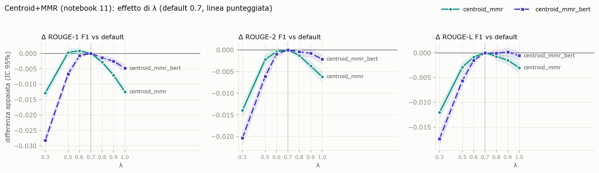
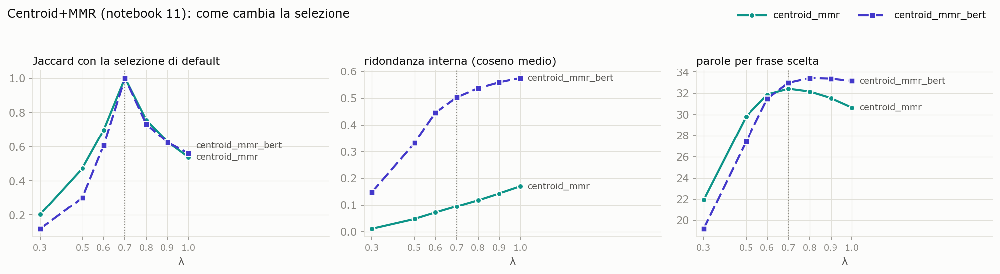
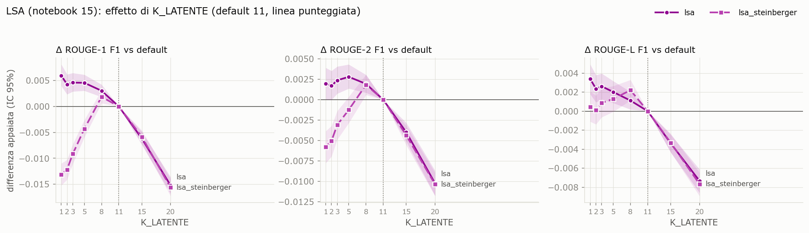
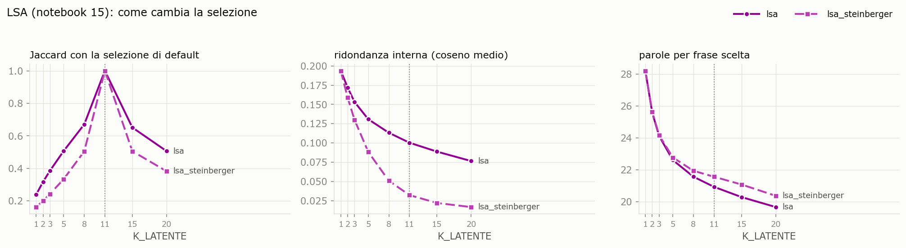
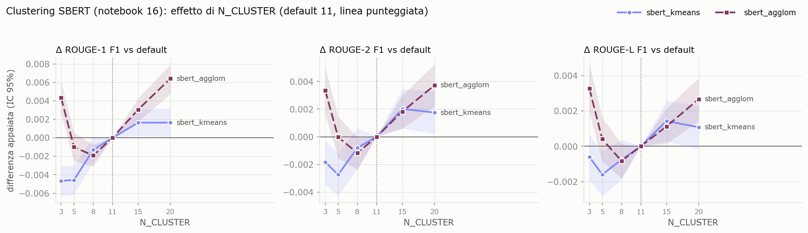
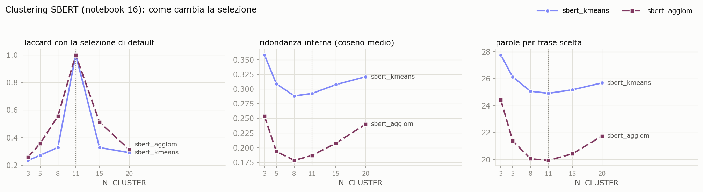

# Sensibilità degli iperparametri dei metodi estrattivi

*Documento riassuntivo dello studio. Stato: step 1-3 (Centroid+MMR, LSA, clustering SBERT)
completati, step 4 (LDA) da fare.*

## 1. Perché questo studio

Gli undici estrattivi del benchmark girano con valori degli iperparametri che sono
**convenzioni o default di libreria, mai tarati**: `K_LATENTE = 11` per LSA, `λ = 0.7` per
Centroid+MMR, `N_CLUSTER = 11` per il clustering SBERT, `N_TOPICS = 5` e i priori di default per
LDA. I notebook 15 e 17 lo dichiarano nelle loro sezioni «Limiti». Lo studio vuole capire, in modo
**qualitativo**, quanto le conclusioni del benchmark dipendono da queste scelte: quali parametri
spostano davvero le metriche, in che direzione e se cambia l'ordine fra i metodi.

## 2. Protocollo

| Aspetto | Scelta | Motivo |
|---|---|---|
| Righe | split test pulita, 5.610 cluster (5.588 valutati: 22 righe fanno fallire la segmentazione di pyAutoSummarizer, come nel benchmark) | stesse righe dei numeri pubblicati |
| Lunghezza | **bloccata alla lunghezza del riferimento** e troncata al tetto di 1,25 × riferimento (protocollo `test_budgetref`, issue #16) | senza il budget alcuni parametri cambierebbero soprattutto la lunghezza, e ROUGE premierebbe la lunghezza (è ciò che gonfiava LDA) |
| Metriche | ROUGE-1/2/L F1, BLEU, METEOR di pyAutoSummarizer | basso costo; **nessuna metrica basata su LLM**, niente BERTScore |
| Confronto | differenza **appaiata per riga** rispetto al default, IC 95% bootstrap (2.000 ricampionamenti) | le righe sono le stesse per tutti i valori, quindi la varianza fra cluster si elimina |
| Diagnostica | Jaccard fra le frasi scelte e quelle del default, ridondanza interna (coseno medio fra le frasi scelte), parole per frase, quota in banda [0,80 R, tetto] | per vedere *come* cambia la selezione, non solo *quanto* cambiano le metriche |
| Encoder | sempre `all-MiniLM-L6-v2` | scelta dell'autore: si studiano i parametri del metodo, non l'encoder |

**Avvertenze.** È un'esplorazione **sul test**: un valore «migliore» trovato qui è scelto
guardando il test e non va presentato come prestazione del metodo, che per una taratura vera
andrebbe scelto su validation. I numeri pubblicati del benchmark non cambiano. ROUGE di
pyAutoSummarizer usa insiemi di n-grammi unici, quindi i valori non sono confrontabili con la
letteratura ma lo sono fra loro.

**Riproducibilità.** Il driver (`esegui_sensibilita.py`) contiene una copia letterale delle
funzioni di generazione dei notebook e verifica che il valore di default riproduca i riassunti
pubblicati. Esito della verifica, sui 5.588 cluster:

| Slug (default) | Riassunti identici al pubblicato | Differenza massima fra le medie delle metriche |
|---|---|---|
| `lsa`, `lsa_steinberger` (K = 11) | 5.588 / 5.588 | 0 |
| `centroid_mmr` (λ = 0,7) | 5.588 / 5.588 | 0 |
| `centroid_mmr_bert` (λ = 0,7) | 5.555 / 5.588 (33 diverse, 0,6%) | 0,0002 |
| `sbert_kmeans` (N = 11) | 4.135 / 5.588 (1.453 diverse, 26%) | 0,0007 |
| `sbert_agglom` (N = 11, average) | 3.032 / 5.588 (2.556 diverse, 46%) | 0,0003 |

Le 33 righe di `centroid_mmr_bert` sono quasi-pareggi del greedy MMR: gli embedding MiniLM
ricalcolati qui (PyTorch su CPU) differiscono dagli originali nelle ultime cifre decimali. Il
TF-IDF è deterministico e infatti coincide ovunque. Il clustering SBERT amplifica le stesse
differenze minime fino a cambiare una frase in un quarto-metà delle righe (vedi §6), ma le metriche
medie coincidono: per questo step l'equivalenza col default si giudica sulle metriche.

## 3. Perimetro

| Step | Notebook | Slug | Iperparametro | Griglia | Stato |
|---|---|---|---|---|---|
| 1 | 11 Centroid+MMR | `centroid_mmr`, `centroid_mmr_bert` | λ | 0.3, 0.5, 0.6, **0.7**, 0.8, 0.9, 1.0 | **fatto** |
| 2 | 15 LSA | `lsa`, `lsa_steinberger` | `K_LATENTE` | 1, 2, 3, 5, 8, **11**, 15, 20 | **fatto** |
| 3 | 16 SBERT clustering | `sbert_kmeans`, `sbert_agglom` | `N_CLUSTER`; linkage (solo agglom., N = 11) | 3, 5, 8, **11**, 15, 20; **average**, complete, single | **fatto** |
| 4 | 17 LDA | `lda` | `N_TOPICS` × α, seme | — | da fare |

In grassetto il default del benchmark. Esclusi per scelta (priorità bassa): damping di
TextRank/LexRank, η di LDA, First-k, cambio di encoder.

## 4. Centroid+MMR — λ (step 1)

Centroid+MMR rappresenta ogni frase come vettore (TF-IDF per `centroid_mmr`, embedding MiniLM per
`centroid_mmr_bert`), calcola il centroide del cluster e aggiunge una frase alla volta
massimizzando `λ · rilevanza − (1 − λ) · ridondanza`. La rilevanza è il coseno con il centroide;
la ridondanza è la massima similarità con le frasi già scelte. Con λ = 1 la ridondanza non conta:
è il **Centroid puro** (MEAD senza MMR). Nel benchmark λ = 0,7.

### Risultati

| λ | `centroid_mmr` R1 F1 | Δ R1 [IC 95%] | Δ R2 [IC 95%] | `centroid_mmr_bert` R1 F1 | Δ R1 [IC 95%] | Δ R2 [IC 95%] |
|---|---|---|---|---|---|---|
| 0.3 | 0.3651 | −0.0129 [−0.0145, −0.0112] | −0.0140 [−0.0157, −0.0124] | 0.3361 | −0.0282 [−0.0299, −0.0263] | −0.0203 [−0.0221, −0.0186] |
| 0.5 | 0.3782 | +0.0003 [−0.0011, +0.0016] | −0.0022 [−0.0034, −0.0010] | 0.3575 | −0.0067 [−0.0082, −0.0052] | −0.0061 [−0.0075, −0.0047] |
| 0.6 | **0.3788** | +0.0009 [−0.0000, +0.0018] | −0.0004 [−0.0013, +0.0005] | 0.3635 | −0.0007 [−0.0018, +0.0003] | −0.0010 [−0.0020, −0.0000] |
| **0.7** | 0.3779 | — | — | **0.3643** | — | — |
| 0.8 | 0.3751 | −0.0028 [−0.0037, −0.0020] | −0.0013 [−0.0021, −0.0005] | 0.3628 | −0.0014 [−0.0023, −0.0005] | −0.0005 [−0.0013, +0.0004] |
| 0.9 | 0.3708 | −0.0071 [−0.0081, −0.0060] | −0.0037 [−0.0048, −0.0026] | 0.3617 | −0.0025 [−0.0036, −0.0014] | −0.0008 [−0.0019, +0.0002] |
| 1.0 | 0.3655 | −0.0124 [−0.0138, −0.0111] | −0.0062 [−0.0074, −0.0050] | 0.3594 | −0.0048 [−0.0060, −0.0036] | −0.0021 [−0.0033, −0.0010] |

Lunghezza media 214,7–215,3 parole, 97,7–98,7% delle righe in banda in tutte le configurazioni.

| λ | `centroid_mmr` Jaccard vs 0,7 | ridondanza | parole/frase | METEOR | `_bert` Jaccard | ridondanza | parole/frase | METEOR |
|---|---|---|---|---|---|---|---|---|
| 0.3 | 0.21 | 0.011 | 22.0 | 0.405 | 0.12 | 0.149 | 19.2 | 0.383 |
| 0.5 | 0.48 | 0.047 | 29.8 | **0.417** | 0.30 | 0.332 | 27.5 | 0.407 |
| 0.6 | 0.70 | 0.072 | 31.9 | 0.416 | 0.61 | 0.446 | 31.5 | 0.413 |
| 0.7 | 1 | 0.095 | 32.4 | 0.413 | 1 | 0.503 | 33.0 | **0.413** |
| 0.8 | 0.76 | 0.118 | 32.2 | 0.408 | 0.73 | 0.537 | 33.4 | 0.410 |
| 0.9 | 0.63 | 0.144 | 31.5 | 0.401 | 0.63 | 0.559 | 33.4 | 0.408 |
| 1.0 | 0.54 | 0.171 | 30.7 | 0.392 | 0.56 | 0.575 | 33.2 | 0.405 |

La ridondanza è misurata nello spazio di ciascuna variante: TF-IDF ed embedding densi hanno
scale di coseno diverse (fra frasi dello stesso cluster ~0,1 contro ~0,5), quindi le due colonne
si leggono ciascuna per sé, non l'una contro l'altra.

### Lettura

1. **Il default λ = 0,7 è già sull'ottimo, per entrambe le varianti.** Con TF-IDF c'è un
   altopiano fra 0,5 e 0,7: ROUGE-1 varia di ±0,001 con intervalli che includono lo zero, mentre
   ROUGE-2 e ROUGE-L hanno il massimo proprio a 0,7. Con BERT 0,7 è il massimo di ROUGE-1, ROUGE-2
   e METEOR. Fra le metriche, solo METEOR con TF-IDF preferisce λ = 0,5 (+0,004).
2. **Quanto vale l'MMR.** Passare dal Centroid puro (λ = 1) al default guadagna **+0,012 di
   ROUGE-1 con TF-IDF** e **+0,005 con BERT**. Senza penalità la selezione è più ridondante
   (TF-IDF 0,17 contro 0,10): il centroide attira frasi che dicono la stessa cosa.
3. **Troppa diversità costa più di nessuna diversità.** A λ = 0,3 il termine di novità domina:
   vengono scelte frasi corte e periferiche, lontane da tutto (22 e 19 parole per frase contro
   32-33), quasi prive di ridondanza ma anche di contenuto centrale. Il calo (−0,013 TF-IDF,
   −0,028 BERT) è pari o maggiore di quello del Centroid puro.
4. **BERT è asimmetrico.** Sopra 0,7 la curva BERT è quasi piatta (−0,005 a λ = 1), sotto
   crolla. Con embedding densi tutte le frasi di un cluster sono già simili (coseno ~0,5), quindi
   il termine `max sim` è grande e quasi costante. Appena il suo peso cresce sovrasta la
   rilevanza e premia le frasi anomale. La stessa λ non ha lo stesso significato nei due spazi:
   un λ «universale» non esiste.
5. **Selezioni diverse, metriche vicine.** Come per LSA, fra λ = 0,6 e 0,7 cambia circa un terzo
   delle frasi (Jaccard 0,70 TF-IDF, 0,61 BERT) mentre ROUGE-1 si muove di meno di 0,001.

### Effetto sul confronto fra metodi

**TF-IDF batte BERT a ogni valore di λ**: il miglior `centroid_mmr_bert` (0,3643, λ = 0,7) è
sotto `centroid_mmr` per **ogni** λ della griglia, estremi compresi. Il divario pubblicato (0,014) non dipende dalla
scelta di λ. `centroid_mmr` resta il miglior estrattivo a lunghezza bloccata in tutta la griglia
tranne agli estremi (0,3 e 1,0), dove scende a 0,365, sotto `lsa_steinberger` (0,369) e `firstk_*`
(0,368).

## 5. LSA — `K_LATENTE` (step 2)

`K_LATENTE` è il numero di dimensioni latenti tenute dalla SVD della matrice frase × termine
TF-IDF di ogni cluster. Nel benchmark vale 11 per convenzione (= numero di frasi da estrarre,
Gong & Liu). Le due varianti condividono la SVD e differiscono nella selezione: `lsa` prende le
frasi con il vettore latente più lungo (top-k), `lsa_steinberger` sceglie una frase alla volta e
sottrae la sua direzione dallo spazio (deflazione, anti-ridondanza).

### Risultati

| K | `lsa` R1 F1 | Δ R1 [IC 95%] | Δ R2 | `lsa_steinberger` R1 F1 | Δ R1 [IC 95%] | Δ R2 |
|---|---|---|---|---|---|---|
| 1 | **0.3563** | +0.0059 [+0.0040, +0.0081] | +0.0020 | 0.3563 | −0.0131 [−0.0152, −0.0110] | −0.0058 |
| 2 | 0.3546 | +0.0043 [+0.0023, +0.0062] | +0.0017 | 0.3572 | −0.0122 [−0.0141, −0.0103] | −0.0050 |
| 3 | 0.3549 | +0.0046 [+0.0029, +0.0064] | +0.0024 | 0.3602 | −0.0092 [−0.0111, −0.0073] | −0.0031 |
| 5 | 0.3549 | +0.0045 [+0.0030, +0.0061] | +0.0028 | 0.3651 | −0.0043 [−0.0060, −0.0026] | −0.0012 |
| 8 | 0.3534 | +0.0030 [+0.0018, +0.0042] | +0.0019 | **0.3712** | +0.0018 [+0.0006, +0.0031] | +0.0018 |
| **11** | 0.3503 | — | — | 0.3694 | — | — |
| 15 | 0.3442 | −0.0062 [−0.0074, −0.0049] | −0.0040 | 0.3635 | −0.0059 [−0.0071, −0.0046] | −0.0044 |
| 20 | 0.3351 | −0.0152 [−0.0168, −0.0136] | −0.0102 | 0.3538 | −0.0156 [−0.0173, −0.0140] | −0.0103 |

Lunghezza media 214,6–215,1 parole in tutte le configurazioni, 97,7–98,8% delle righe in banda:
le differenze non vengono dalla lunghezza.

| K | `lsa` Jaccard vs K=11 | `lsa` ridondanza | `lsa` parole/frase | `steinberger` Jaccard | `steinberger` ridondanza | `steinberger` METEOR |
|---|---|---|---|---|---|---|
| 1 | 0.24 | 0.194 | 28.2 | 0.16 | 0.194 | 0.379 |
| 3 | 0.39 | 0.153 | 24.1 | 0.24 | 0.130 | 0.381 |
| 5 | 0.51 | 0.131 | 22.6 | 0.33 | 0.088 | 0.389 |
| 8 | 0.67 | 0.113 | 21.6 | 0.51 | 0.051 | 0.401 |
| 11 | 1 | 0.100 | 20.9 | 1 | 0.032 | **0.404** |
| 15 | 0.65 | 0.089 | 20.3 | 0.51 | 0.022 | 0.401 |
| 20 | 0.51 | 0.076 | 19.7 | 0.38 | 0.017 | 0.393 |

### Lettura

1. **Le due varianti rispondono a K in modo opposto sotto il default.** `lsa` è quasi piatta fra
   K=1 e K=5 (+0,004/+0,006 su ROUGE-1) e peggiora oltre; `lsa_steinberger` invece cresce con K
   fino a un massimo a K=8 e scende di poco a K=11. Conferma l'indicazione preliminare scritta nel
   notebook 15, che era stata ottenuta su ~400 righe.
2. **Oltre 11 dimensioni peggiorano entrambe, e allo stesso modo** (−0,006 a K=15, −0,015 a
   K=20, con curve sovrapposte). Le dimensioni in più sono concetti deboli, spesso una frase
   isolata che non condivide termini con le altre e diventa da sola un «concetto»: entrambe le
   regole finiscono per premiare frasi corte e periferiche (le parole per frase scendono da 21 a
   20). È il limite n. 1 del notebook 15 che si manifesta.
3. **Con K piccolo `lsa` sceglie frasi più lunghe e più centrali.** Con una sola dimensione la
   salienza è la proiezione sul tema dominante del cluster: le frasi scelte sono più lunghe
   (28 contro 21 parole) e più simili fra loro (ridondanza 0,19 contro 0,10). Più ridondanza ma
   anche più contenuto «centrale»: a lunghezza bloccata il secondo effetto vince di poco.
4. **Per `lsa_steinberger` K è anche la profondità dell'anti-ridondanza.** Dopo K scelte lo spazio
   residuo si esaurisce e l'ordine prosegue per salienza originale, cioè come `lsa`. Con K=1 le
   due varianti producono **esattamente lo stesso riassunto**. Al crescere di K la ridondanza
   scende in modo monotono (0,19 → 0,017) e il guadagno arriva fino a K≈8-11, poi il residuo è
   fatto di frasi isolate.
5. **Selezioni molto diverse, metriche quasi uguali.** Fra K=8 e K=11 la Jaccard è 0,67 (`lsa`) e
   0,51 (`steinberger`), cioè metà delle frasi cambia, ma ROUGE-1 si muove di 0,002-0,003. Molte
   selezioni diverse sono equivalenti per ROUGE: le differenze fra valori vicini sono reali
   (gli IC escludono lo zero) ma piccole.
6. **Le metriche non concordano sul massimo di `lsa_steinberger`**: ROUGE-1/2/L lo trovano a K=8,
   METEOR (0,404) e BLEU (0,117) a K=11. Il default è quindi già a ridosso dell'ottimo per questa
   variante.

### Effetto sul confronto fra metodi

| | `lsa` | `lsa_steinberger` | divario |
|---|---|---|---|
| K=11 (pubblicato) | 0.3503 | 0.3694 | 0.0191 |
| K migliore per variante | 0.3563 (K=1) | 0.3712 (K=8) | 0.0149 |

Il default K=11 **favoriva `lsa_steinberger`**, come ammesso nel notebook 15: con il K migliore
per ciascuna il divario scende di circa un quinto (0,019 → 0,015) ma **non si inverte**. La
deflazione resta nettamente migliore della top-k. Nella classifica degli estrattivi a lunghezza
bloccata (ROUGE-1 F1 pubblicati: `centroid_mmr` 0,378, `firstk_*` 0,368, `textrank` 0,359,
`sbert_kmeans` 0,360, `lexrank` 0,352) `lsa` con K=1 supererebbe solo `lexrank`, e
`lsa_steinberger` con K=8 (0,371) passerebbe davanti a `firstk_*`, comunque dietro
`centroid_mmr`. Sono spostamenti di qualche millesimo: il quadro del benchmark non cambia.

## 6. Clustering SBERT — `N_CLUSTER` e linkage (step 3)

Il metodo codifica le frasi con MiniLM, le raggruppa in `N_CLUSTER` gruppi (k-means per
`sbert_kmeans`, agglomerativo con distanza coseno per `sbert_agglom`) e sceglie per ogni gruppo la
frase più vicina al centroide (medoide). A lunghezza bloccata le frasi entrano **a giri**: prima i
medoidi di tutti i gruppi, dal più grande al più piccolo, poi i secondi rappresentanti, e così via
fino al budget. Nel benchmark `N_CLUSTER = 11` (pari al numero di frasi da estrarre) e il linkage
dell'agglomerativo è `average`. Con il budget in parole `N_CLUSTER` non fissa più la lunghezza:
diventa un vero iperparametro, la granularità dei sottotemi.

**Il metodo è numericamente instabile.** Con un rumore di 1e-6 sugli embedding la selezione
cambia in circa metà delle righe; rispetto ai riassunti pubblicati (embedding calcolati in
un'altra corsa) differiscono 1.453 righe su 5.588 per `sbert_kmeans` (26%) e 2.556 per
`sbert_agglom` (46%). Le metriche medie però coincidono con quelle pubblicate entro 0,0007: gli
scambi avvengono quasi sempre fra frasi quasi duplicate (la stessa frase d'agenzia ripresa da più
articoli), che hanno embedding quasi identici. È la generalizzazione del pareggio esatto del
medoide documentato nel notebook 16 per la riga 50492. Conseguenza per la lettura: la Jaccard
rispetto al default è bassa (~0,3 anche fra valori vicini) anche per questo motivo, e non misura
solo l'effetto del parametro.

### Risultati: `N_CLUSTER`

| N | `sbert_kmeans` R1 F1 | Δ R1 [IC 95%] | Δ R2 [IC 95%] | `sbert_agglom` R1 F1 | Δ R1 [IC 95%] | Δ R2 [IC 95%] |
|---|---|---|---|---|---|---|
| 3 | 0.3550 | −0.0047 [−0.0063, −0.0030] | −0.0018 [−0.0035, −0.0003] | 0.3440 | +0.0043 [+0.0026, +0.0061] | +0.0033 [+0.0016, +0.0050] |
| 5 | 0.3551 | −0.0046 [−0.0061, −0.0030] | −0.0027 [−0.0043, −0.0012] | 0.3387 | −0.0010 [−0.0026, +0.0006] | −0.0000 [−0.0015, +0.0015] |
| 8 | 0.3583 | −0.0013 [−0.0027, +0.0001] | −0.0008 [−0.0023, +0.0006] | 0.3378 | −0.0019 [−0.0031, −0.0008] | −0.0012 [−0.0024, −0.0000] |
| **11** | 0.3596 | — | — | 0.3397 | — | — |
| 15 | **0.3613** | +0.0016 [+0.0002, +0.0031] | +0.0020 [+0.0006, +0.0034] | 0.3427 | +0.0031 [+0.0017, +0.0043] | +0.0018 [+0.0006, +0.0030] |
| 20 | **0.3613** | +0.0016 [+0.0001, +0.0032] | +0.0017 [+0.0002, +0.0033] | **0.3461** | +0.0064 [+0.0047, +0.0079] | +0.0037 [+0.0022, +0.0052] |

| N | `kmeans` ridondanza | `kmeans` parole/frase | `agglom` ridondanza | `agglom` parole/frase | `agglom` METEOR |
|---|---|---|---|---|---|
| 3 | 0.358 | 27.8 | 0.254 | 24.4 | 0.391 |
| 5 | 0.309 | 26.1 | 0.194 | 21.4 | 0.386 |
| 8 | 0.288 | 25.1 | 0.178 | 20.1 | 0.385 |
| 11 | 0.292 | 24.9 | 0.187 | 19.9 | 0.387 |
| 15 | 0.308 | 25.2 | 0.208 | 20.4 | 0.391 |
| 20 | 0.321 | 25.7 | 0.240 | 21.7 | 0.395 |

Lunghezza media 214,7–215,3 parole, 97,8–98,6% delle righe in banda. Il METEOR medio di
`sbert_kmeans` con N = 3 e N = 20 (−0,15 e −0,14) è falsato da una sola riga, la 50540 (METEOR
−3.074, la sorgente degenere già documentata per `lexrank` e `lda`), e per quelle due
configurazioni va ignorato; con gli altri N vale 0,403-0,409.

### Risultati: linkage dell'agglomerativo (`N_CLUSTER = 11`)

| linkage | R1 F1 | Δ R1 [IC 95%] | Δ R2 [IC 95%] | Δ RL [IC 95%] | METEOR | ridondanza | parole/frase |
|---|---|---|---|---|---|---|---|
| **average** | 0.3397 | — | — | — | 0.387 | 0.187 | 19.9 |
| complete | **0.3527** | +0.0130 [+0.0115, +0.0144] | +0.0075 [+0.0062, +0.0088] | +0.0059 [+0.0048, +0.0070] | **0.402** | 0.248 | 23.2 |
| single | 0.3272 | −0.0125 [−0.0140, −0.0110] | −0.0079 [−0.0093, −0.0065] | −0.0055 [−0.0067, −0.0043] | 0.376 | 0.172 | 19.1 |

### Lettura

1. **Il linkage conta più di `N_CLUSTER`.** Passare da `average` a `complete` vale +0,013 di
   ROUGE-1, il doppio di qualunque variazione di `N_CLUSTER`; `single` perde altrettanto.
   L'ordine `complete > average > single` è quello atteso: il legame singolo concatena le frasi in
   un unico gruppo gigante lasciando isolate le frasi anomale; il legame completo forma gruppi
   compatti e bilanciati; `average` sta in mezzo.
2. **Perché i gruppi sbilanciati fanno male.** Ogni gruppo, anche di una sola frase, contribuisce
   un medoide al primo giro. Se il clustering lascia molte frasi isolate, quei «gruppi» sono frasi
   anomale (brevi, periferiche) e finiscono nel riassunto prima dei secondi rappresentanti dei temi
   veri. Le parole per frase lo mostrano: 19-20 con `average`/`single`, 23 con `complete`, 25 con
   k-means.
3. **`sbert_agglom` ha una curva a U in `N_CLUSTER`, con il default vicino al minimo.** Con pochi
   gruppi (N = 3) gli isolati sono pochi e il primo giro pesca medoidi di gruppi grandi; con molti
   gruppi (N = 20) il budget (~8-11 frasi) si esaurisce dentro il primo giro, che va dal gruppo più
   grande al più piccolo, e gli isolati in coda restano fuori. Fra 5 e 11 il primo giro include
   molti isolati: è la zona peggiore, e 11 ci sta dentro (+0,006 a N = 20).
4. **`sbert_kmeans` è quasi piatto e migliora appena con N più alto** (+0,0016 a 15 e 20, al limite
   della significatività; −0,005 con N ≤ 5). K-means tende a gruppi di dimensione comparabile,
   quindi il problema degli isolati non si presenta e la granularità conta poco.

### Effetto sul confronto fra metodi

| | `sbert_kmeans` | `sbert_agglom` | divario |
|---|---|---|---|
| default (N = 11, average) | 0.3596 | 0.3397 | 0.0199 |
| migliore della griglia | 0.3613 (N = 15/20) | 0.3527 (complete) | 0.0086 |

Il divario pubblicato fra k-means e agglomerativo (0,020) è **per più di metà un effetto del
linkage `average`**: con `complete` scende a 0,009, ma k-means resta davanti. `sbert_agglom` con
`complete` (0,353) salirebbe dal penultimo posto fra gli estrattivi a lunghezza bloccata
(davanti solo a `lda`, 0,338), superando `lsa` (0,350) e `lexrank` (0,352) e restando sotto
`textrank` (0,359). Fra i
parametri studiati finora è lo spostamento più grande della classifica.

## 7. Conclusioni (provvisorie)

- **Centroid+MMR**: λ = 0,7 è già l'ottimo per entrambe le varianti; l'MMR vale circa +0,012 di
  ROUGE-1 con TF-IDF e +0,005 con BERT rispetto al Centroid puro. Eccedere in diversità (λ basso)
  è peggio che non averne. TF-IDF > BERT a ogni λ: il risultato pubblicato non dipende da λ.
- **LSA**: `K_LATENTE` conta, ma meno della scelta della regola di selezione. Il default è
  vicino all'ottimo per `lsa_steinberger` e lontano per `lsa`; correggerlo riduce il divario fra
  le due varianti senza invertirlo.
- **Clustering SBERT**: il parametro che conta è il linkage, non `N_CLUSTER`: `complete` vale
  +0,013 su `average` e dimezza il divario con k-means. `N_CLUSTER` sposta k-means di pochi
  millesimi; l'agglomerativo ha una U con il default vicino al minimo. Il metodo è instabile agli
  errori di arrotondamento degli embedding, ma solo nel testo, non nelle metriche.

- **Trasversale (finora)**: in tutti i metodi valori vicini dell'iperparametro producono
  selezioni molto diverse (un terzo-metà delle frasi cambia) con metriche quasi uguali; gli
  spostamenti di ROUGE-1 entro ±0,005 dal default sono la norma, quelli maggiori arrivano solo ai
  bordi della griglia o con un cambio di regola (il linkage). Nessun ordinamento fra varianti dello
  stesso metodo si inverte, e i default scelti per convenzione sono quasi sempre vicini all'ottimo:
  le eccezioni sono `lsa` (K troppo alto) e `sbert_agglom` (linkage `average`).

*Le conclusioni trasversali saranno completate al termine dello step 4.*
